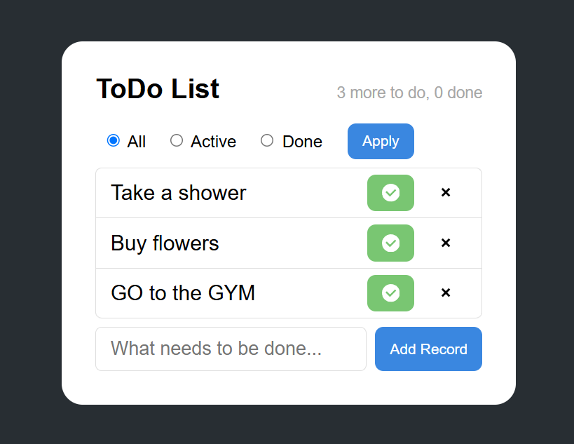

# ToDoList

A simple web-based To-Do List application built with Java and Spring MVC.

> **Current version: MVP — 0.0.0**

The project is currently in active development. 

## Features

- Add new tasks
- Display all tasks
- Filter tasks by status:
    - All
    - Active
    - Done
- Mark tasks as completed
- Delete tasks
- Display the number of active and completed tasks
- Responsive and clean user interface

## Tech Stack

- Java 21
- Spring MVC
- JSP
- JSTL
- Maven
- Apache Tomcat 10.1
- HTML5
- CSS3
- PostgreSQL 16
- Hibernate 6

## Project Structure

```text
src/
└── main/
    ├── java/
    │   └── org/example/
    │       ├── config/
    │       ├── controller/
    │       ├── dao/
    │       ├── dto/
    │       ├── entity/
    │       └── service/
    │
    └── webapp/
        ├── resources/
        │   └── css/
        └── WEB-INF/
            └── views/
                └── main-page.jsp
```            

The application follows a simple layered structure:
- Controller — handles HTTP requests
- Service — contains application logic
- DAO — manages task data
- Entity — represents a task
- DTO — transfers grouped data to the view
- JSP — renders the user interface

## Running the Application
Requirements:
- JDK 21+
- Maven
- Apache Tomcat 10.1+
```text
mvn clean package
```
This will generate: 
```text
target/ToDoList.war
```
Deploy the WAR file to Apache Tomcat and start the server.

The application will be available at:
```text
http://localhost:8081/ToDoList
```

## Running PostgreSQL
PostgreSQL can be started using Docker:
```bash
docker run -d `
  --name todolist-postgres `
  -p 5433:5432 `
  -e POSTGRES_DB=todolist `
  -e POSTGRES_USER=postgres `
  -e POSTGRES_PASSWORD=postgres `
  -v todolist_pgdata:/var/lib/postgresql/data `
  --restart unless-stopped `
  postgres:16-alpine
 ```
Before launching the application, spin up a PostgreSQL container.
## Preview

